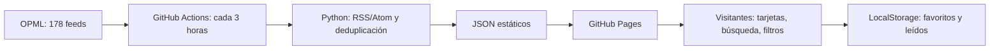

# Radar RSS · Lector público de noticias

**Versión pública operativa · octubre 2026:** recopilación y publicación automáticas, monitoreo, historial paginado, tendencias, lectura responsive y pruebas multiplataforma.

Proyecto público sin backend ni cuentas. El catálogo contiene 178 fuentes RSS y seis carpetas OPML. Las carpetas personales se configuran localmente sin modificar el catálogo público. El listado ofrece una vista conjunta de Latinoamérica sin ocultar ni modificar las carpetas de fuentes.

## Arquitectura



- **Fuentes:** `sources/feeds.opml`. Suscripciones agrupadas en inteligencia artificial, tecnología, internacionales, Chile, Venezuela y Latinoamérica.
- **Colector:** `scripts/collect.py`, Python + feedparser + requests. Obtiene los feeds con concurrencia limitada, normaliza titulares, extractos, imágenes y fechas, deduplica por URL y retiene artículos hasta 45 días (sujeto al límite de 5.000 artículos y a la disponibilidad del historial). Si un feed falla, mantiene datos antiguos dentro del período de retención gracias a la caché de GitHub Actions.

- **Integridad de fuentes:** `scripts/audit_feeds.py` valida el OPML sin consultar internet y se ejecuta antes de recopilar noticias. Los errores temporales admiten un reintento con espera aleatoria; un feed permanentemente bloqueado no se reintenta.
- **Contadores de medios:** el selector de fuentes puede mostrar noticias disponibles dentro de los filtros vigentes; no expresa la cantidad total histórica publicada por cada periódico.
- **Vigilancia:** `web/data/status.json`. Registra errores, feeds vacíos y feeds con última publicación fechada hace al menos 365 días. Una fuente no se elimina automáticamente: un feed roto no implica un medio inactivo.
- **Publicación:** `.github/workflows/deploy.yml`, GitHub Actions -> GitHub Pages. El navegador consume JSON generado, sin solicitar RSS externos directamente (evita CORS).
- **UI:** `web/index.html`, `web/app.js` y los módulos `library.js`, `features.js`, `v12.js`. Interfaz sin frameworks con filtros combinables, Mi Radar, búsqueda guardada, vista de lectura, resumen personalizado y modos claro/oscuro.

## Funciones para lectores

- **Lo más cubierto y el radar.** Las historias publicadas por más medios distintos en 24 h, en una lista numerada y en un radar (sector = tema, distancia = antigüedad, tamaño = cobertura). Es una señal de importancia que no depende de clics.
- **Cómo lo cuenta cada medio.** Al abrir una historia agrupada, los titulares de cada medio, separados por región y fuentes oficiales, sin valoraciones.
- **Seguimiento de una historia.** Línea de tiempo con las notas relacionadas de los últimos días.
- **Temas en alza** (`data/trends.json`). Palabras cuyo uso en titulares crece frente a los 7 días anteriores, con mínimos de historias y de fuentes.
- **Temas que sigo, «Mientras no estabas», Resumen del día** (escuchar, copiar o compartir por WhatsApp) y **atajos de teclado** (`?`). Todo se guarda solo en el navegador.
- **Modo ligero y lectura sin conexión** (`sw.js`): red primero; sin conexión, la última copia del propio sitio.
- **Feeds de salida** en `feeds/`: `mas-cubierto.xml` y uno por carpeta.

## Continuidad de lectura y filtros

- Los filtros activos se muestran con su alcance y pueden quitarse por separado. «Limpiar filtros» conserva las preferencias de fuentes ocultas, palabras silenciadas y ocultar leídas; sus etiquetas permiten abrir el ajuste correspondiente.
- En móvil, «Filtros» agrupa los controles existentes e indica cuántos están activos. Los estados sin resultados ofrecen una acción específica para ampliar la búsqueda.
- Una nueva publicación se anuncia mediante «Mostrar noticias»: el listado actual permanece disponible hasta que el lector decide actualizarlo.
- Marcar un lote como leído muestra la cantidad cambiada y permite «Deshacer» durante ocho segundos, conservando las marcas previas y otras acciones posteriores.
- La vista previa incorpora Anterior/Siguiente, posición dentro del listado filtrado y «Marcar como no leída». Al cerrarla recupera el contexto del listado.
- Configuración explica que los cambios se guardan automáticamente en este navegador; «Listo» cierra el diálogo.

## Interacción y personalización V1.2

- **Latinoamérica:** 54 fuentes distribuidas entre Chile (22), Venezuela (22) y medios latinoamericanos de alcance regional (10). Los filtros no repiten estas categorías: el lector navega por **Todas las noticias** o por las seis carpetas originales de la barra lateral. La vista agregada de Latinoamérica sigue disponible mediante su acceso de noticias y los enlaces antiguos; no modifica las carpetas ni sus menús.
- **Portada limpia:** las categorías ya están disponibles en las seis carpetas del lateral; no se repiten como botones grandes en Inicio. La selección opcional de intereses se encuentra en **Configuración → Lectura y filtros → Personalizar portada** (plegada), conservando las preferencias locales y el resumen por intereses. Desactivarla devuelve la portada general. Las tarjetas usan solo un icono para marcar lectura, con descripción accesible y estado visual.
- **Barra de noticias compacta:** los controles de fuente, etiqueta, antigüedad y presentación comparten una única barra. «Guardar búsqueda» y «Marcar visibles como leídas» se muestran como iconos con nombre accesible y ayuda al pasar el cursor; no hay segunda franja ni contador repetido bajo los filtros. Marcar visibles afecta solo las tarjetas cargadas que coinciden con los filtros, mientras que el menú contextual «Todas las noticias» puede abarcar también el historial tras confirmación.
- **Filtros combinables:** se pueden cruzar la carpeta seleccionada en la barra lateral, antigüedad, medio RSS, búsqueda textual y estado de lectura, sin un selector geográfico duplicado. Se conservan hasta 12 combinaciones locales y las búsquedas anteriores con criterios «Chile», «Venezuela», «Región» y «Latinoamérica» siguen funcionando; no se realiza una búsqueda web externa.
- **Comparación:** para las historias agrupadas de dos o más enlaces editoriales, se puede alternar entre medios/regiones y cronología usando las fechas publicadas; el sistema no asigna intenciones ni sesgos a los medios.
- **Resumen personalizado:** escoger todas las secciones, intereses de Mi Radar, Latinoamérica o fuentes de un país; la selección se utiliza también al copiar, compartir o escuchar el resumen.
- **Menú contextual de Todas las noticias:** clic derecho, Shift+F10 o pulsación larga para marcar todas las noticias publicadas de fuentes activas como leídas (cargando antes el historial y solicitando confirmación), ver pendientes, abrir el listado o gestionar fuentes. Las carpetas específicas mantienen por separado sus opciones de renombrar, administrar y eliminar; el botón general no es una carpeta editable.
- **Privacidad:** las preferencias y búsquedas permanecen en el dispositivo mediante localStorage. No hay sincronización entre navegadores.

## Tarjetas editoriales y estados de lectura

- **Sin fotografía:** cuando la fuente RSS no publica foto, la URL es inválida o la fotografía original no carga, la cuadrícula usa una cubierta **tipográfica identificada como «Sin fotografía disponible»**, sin imagen inventada ni copia de fotografías ajenas. El modo ligero, la opción «Ocultar imágenes» y la vista Lista omiten la cubierta adicional.
- **Sin descripción:** el colector busca primero el resumen RSS y, si no contiene texto, intenta el campo `description`, el subtítulo y el cuerpo Atom ya entregado por el mismo feed. El texto se limpia y acorta; si la fuente no proporciona contenido útil, no se inventa una descripción. La tarjeta conserva el título, medio y acciones.
- **Sombras por lectura:** las noticias sin leer tienen una elevación suave más visible; las leídas, una sombra más discreta. La distinción se complementa con el contraste del título y el estado del botón. Las transiciones respetan la preferencia de movimiento reducido.
- **Diseño compacto:** las tarjetas mantienen igual altura **dentro de cada fila**, pero una noticia extensa ya no agranda todas las filas del listado. Las imágenes originales son más bajas, las cubiertas tipográficas ocupan menos espacio y los titulares/extractos tienen límites de líneas; el contenido completo sigue disponible en el lector. El modo Compacto, la vista Lista y la noticia principal de portada conservan sus estilos.

## Imágenes originales en noticias

El colector prioriza los campos multimedia de RSS/Atom, incluidos `media:thumbnail`, adjuntos de tipo `image/*` y fotografías incrustadas en el contenido RSS. Si un artículo reciente aún no dispone de foto, el proceso de publicación puede obtener su imagen de previsualización mediante `og:image` o `twitter:image` **en la página original del medio**.

El enriquecimiento se habilita únicamente en el proceso programado mediante `--image-fallback`; los tests y las ejecuciones locales normales permanecen desconectados. Límite: **36 artículos recientes por ejecución**, **2 por dominio**, **4 consultas simultáneas**, con tiempo de espera, tamaño de respuesta y redirecciones restringidos. Antes de cada consulta se comprueba que el dominio esté registrado en el catálogo RSS, sea público y lo permita `robots.txt`. Las comprobaciones fallidas se registran para evitar reintentos durante 36 horas.

Las imágenes se **enlazan al editor original** (no se descargan, republican ni guardan fotografías de terceros en GitHub). Algunos editores no ofrecen fotografía, no permiten la consulta, bloquean enlaces externos o devuelven una imagen no disponible: esas tarjetas permanecen deliberadamente sin foto, con la misma altura que el resto. No se inventan imágenes por IA ni se utilizan fotografías de archivo sin relación con la noticia. El titular y enlace siguen atribuidos al medio de origen.

## Calidad y experiencia V1.3

- **Guía de primer uso:** ayuda contextual en la portada para configurar Mi Radar, combinar filtros y comparar titulares. Se puede cerrar y volver a abrir; no aparece como ventana emergente ni recopila eventos.
- **Estadísticas personales:** solo muestra cuántas noticias se guardaron o marcaron como leídas en este navegador. **No** son estadísticas agregadas de visitantes ni implican telemetría.
- **Rendimiento:** no se construyen las tarjetas del listado cuando se está en la portada o el resumen. El historial se descarga con un máximo de tres fragmentos simultáneos, bajo demanda. Las imágenes de tarjetas siguen usando carga diferida.
- **Accesibilidad:** al guardar una noticia, el foco vuelve al botón correspondiente tras actualizar el listado; los botones de la guía tienen foco visible y el módulo se adapta a pantallas de 320 px. Esto no sustituye la comprobación con lectores de pantalla y dispositivos físicos.
- **Auditoría editorial:** `scripts/audit_editorial.py` examina los JSON publicados y deja en el resumen de GitHub Actions posibles titulares duplicados, URLs RSS idénticas, estados anómalos y atribución ausente. La auditoría no modifica noticias ni certifica su veracidad: requiere revisión humana.
- **Respaldo de datos:** tras una publicación válida, Actions conserva `articles.json`, `status.json`, `sources.json` y `meta.json` en un artefacto llamado `radar-public-data-<ID>` durante **hasta 90 días** (sujeto a la política del repositorio). Esto no es un historial permanente.

### Recuperar un respaldo anterior

1. En **GitHub → Actions → Actualizar noticias y publicar**, identificar la ejecución anterior cuyo respaldo se desea recuperar y copiar su número de ejecución.
2. Comprobar que esa ejecución conserve un artefacto `radar-public-data-<ID>`. El artefacto es una copia de los **datos públicos**, no de preferencias de visitantes.
3. En el mismo workflow, abrir **Run workflow**, indicar `restore_run_id` con ese número e iniciar la ejecución manual.
4. El flujo descarga la copia usando `GITHUB_TOKEN`, comprueba la integridad de identificadores y del estado de feeds y utiliza el respaldo como punto de partida de la siguiente recopilación. Un respaldo corrupto provoca un fallo seguro, sin publicar datos inválidos.

**Limitación:** la recopilación solo conserva un máximo de 45 días o 5.000 artículos, y los artefactos caducan. Para conservación permanente sigue siendo necesario un almacenamiento durable independiente.

## Cómo publicar un fork en GitHub (una sola vez)

1. Crear un **repositorio público** en GitHub llamado, por ejemplo, `radar-rss-publico`. No añadir archivos iniciales al crearlo si subirás esta carpeta completa.
2. Subir **todos los archivos y carpetas**, incluidos `.github/workflows/deploy.yml`, `scripts`, `sources` y `web`. Es importante conservar rutas y estructura.
3. Asegurarse de que la rama principal sea `main`.
4. En el repositorio, abrir **Settings → Pages → Build and deployment → Source → GitHub Actions**.
5. Abrir **Actions → Actualizar noticias y publicar → Run workflow** (si no se ha ejecutado automáticamente por el primer commit). La acción descargará los RSS, generará los JSON y publicará el sitio.
6. Cuando el flujo termine correctamente, el sitio estará normalmente en `https://TU-USUARIO.github.io/radar-rss-publico/`. GitHub muestra la URL real en Settings → Pages.
7. Si se distribuye un fork, revisar enlaces de identidad, `SITE_URL` y el origen de recuperación para evitar mezclar datos con la instancia pública original.

**Opción mediante Git local (después de descomprimir):**

```bash
git init
git branch -M main
git add .
git commit -m "Versión inicial de Radar RSS"
git remote add origin https://github.com/TU-USUARIO/radar-rss-publico.git
git push -u origin main
```

Requiere tener Git instalado y autenticado. No pegues contraseñas ni tokens en el repositorio.

## Estado de calidad y mantenimiento

- **Sitio:** https://medinacaj.github.io/radar-rss-publico/
- **PR y estado vivo:** https://github.com/medinacaj/radar-rss-publico/pulls y `/issues`.
- **CI Python/Node:** `.github/workflows/ci.yml`; se ejecuta en PR y `main`.
- **Navegadores:** `.github/workflows/responsive.yml` ejecuta siete tamaños en Chromium, Firefox y WebKit usando fixtures RSS y HTTPS local, con capturas descargables en los artifacts de CI. WebKit no equivale a un iPhone físico.
- **Accesibilidad:** incluye controles automáticos de estructura, idioma, encabezados y nombres accesibles; falta contrastar la experiencia completa con VoiceOver/TalkBack y dispositivos reales.
- **Supervisión del sitio:** `.github/workflows/monitor.yml` revisa la web tras cada publicación y periódicamente. Una fecha mayor de 18 horas, >=5 RSS con error o una publicación fallida abre una única issue. Al recuperarse, la cierra. Cancelar una publicación reemplazada por otra no se considera incidencia.
- **Historial:** `latest.json` contiene 300 registros y `archive-XX.json` se descarga bajo demanda. El límite total es 5.000 artículos y 45 días como máximo, no un compromiso de conservación permanente.

### Pruebas adicionales de navegador

GitHub Actions ejecuta automáticamente `python browser_tests/responsive_smoke.py chromium`, `firefox` y `webkit`. El script usa certificados HTTPS temporales para reproducir la política de seguridad (CSP) del sitio público y datos locales, sin consultar medios de terceros.
## Prueba local

Requiere Python 3.11+ y acceso a Internet para recopilar noticias:

```bash
python -m pip install -r requirements.txt
python -m unittest discover -s tests -v
python scripts/collect.py --opml sources/feeds.opml --out web/data --days 45
python -m http.server 8000 --directory web
```

Abrir `http://localhost:8000` (no abrir el archivo HTML haciendo doble clic: `fetch` puede estar bloqueado por el navegador).

## Actualización y edición

- **Automática:** aproximadamente cada tres horas mediante cron UTC `17 */6 * * *`. GitHub puede retrasar u omitir alguna ejecución; en repos públicos, la programación puede desactivarse por inactividad prolongada. El flujo también puede iniciarse manualmente.
- **Modificar fuentes:** editar `sources/feeds.opml`, confirmar y esperar el siguiente flujo. No existe límite fijo de fuentes en la aplicación, pero más fuentes incrementan consumo de Actions y tiempo de recopilación.
- **Número de artículos:** 12 por feed por ciclo, hasta 5.000 noticias en caché y un máximo de 45 días por defecto. Ajustable en `deploy.yml` / `collect.py`.
- **Sitio sin noticias después de publicar:** revisar los detalles de `Actions` y `data/status.json`. La aplicación no inventa noticias ni reemplaza automáticamente feeds problemáticos.
- **URL del proyecto:** cambiar el enlace de GitHub en `web/index.html` después de crear el repositorio.

## Límites conocidos de la arquitectura estática

- Favoritos y leídos solo en `localStorage` del navegador; no se sincronizan entre dispositivos ni entre visitantes.
- Sin panel para modificar fuentes desde el sitio público. El OPML se administra en el repositorio para prevenir abusos y SSRF.
- La caché entre ejecuciones de GitHub Actions no constituye almacenamiento permanente y puede caducar o ser desalojada. GitHub Pages tampoco es base de datos. Para histórico duradero y actualización casi en tiempo real, implementar backend y base de datos en versión 2.
- Algunos RSS bloquean servidores automatizados, carecen de fechas, publican sin imágenes, están detrás de muros de pago o tienen licencias que restringen su uso. Solo se muestran extractos breves y enlaces a la fuente original.
- La presentación de una publicación como reciente depende de la fecha proporcionada por el editor. No atribuir fechas inexistentes; se conserva la fecha de primera detección como dato distinto.
- La lista OPML puede contener radares de Google Noticias no indexados de forma completa. Son búsquedas temáticas, no feeds directos del periódico.
- Enlace a imagen externa puede mostrar contenido de terceros o no cargar; las imágenes se presentan sin retransmitirse ni descargarse a un servidor propio.

## Seguridad y privacidad

- No se aceptan nuevos RSS enviados por usuarios anónimos. Los feeds están controlados por el mantenedor en Git.
- Se descartan enlaces de artículos e imágenes que no sean HTTP/HTTPS; la UI representa texto RSS con `textContent`, sin insertar HTML no confiable.
- El colector valida destinos públicos antes de consultar una fuente o seguir redirecciones. Esto es una precaución básica, no una garantía absoluta contra SSRF si se habilitara entrada de URLs no confiables.
- No hay analíticas integradas, cuentas, cookies de la aplicación ni secretos expuestos. GitHub Pages y los medios externos pueden recibir datos normales de conexión del navegador.
- Las marcas y publicaciones son de sus respectivos titulares. El proyecto no reproduce textos completos de los medios.

## Estructura

```text
radar-rss-publico/
├── .github/workflows/deploy.yml
├── sources/feeds.opml
├── scripts/collect.py
├── tests/test_collector.py
├── requirements.txt
├── web/
│   ├── index.html
│   ├── styles.css
│   ├── app.js
│   ├── favicon.svg
│   ├── manifest.webmanifest
│   ├── .nojekyll
│   └── data/
│       ├── sources.json
│       ├── articles.json
│       └── status.json
└── README.md
```

## Hoja de ruta

**V1 — implementada:** lector público estático, OPML, búsqueda y filtros, radar de cobertura, tendencias con cuatro medios independientes, feeds públicos, lector, guardadas y preferencias locales, PWA, diseño responsive y despliegue automatizado.

**V1.1 — implementada parcialmente:** diagnóstico de feeds, vigilancia que abre una incidencia automática si el sitio envejece o acumula fallos, pruebas con Chromium, Firefox y WebKit, historial de hasta 5.000 noticias. Pendientes opcionales: revisión editorial de enlaces inactivos y auditoría asistida con lectores de pantalla reales.

**V1.2 — implementada:** portada Mi Radar, Latinoamérica como navegación agrupada, filtros combinables y búsquedas guardadas, comparador cronológico, resumen segmentado, y pruebas de navegador en móvil y escritorio.

**V1.3 — implementada:** optimización del render del listado y descarga histórica, guía contextual, continuidad de foco y controles táctiles, auditoría editorial orientativa y respaldo recuperable desde Actions. Pendientes de validación física: Safari/iPhone, Android/TalkBack, VoiceOver y pruebas de uso con lectores reales.

**V2 (opcional, sin implementar):** cuentas, sincronización de favoritos entre dispositivos, histórico duradero con base de datos, RSS personalizado, avisos individuales y administración desde un backend. La PWA y la caché sin conexión básica ya existen en V1.

## Licencia

Código creado para este proyecto. Puedes publicarlo y modificarlo bajo licencia MIT (`LICENSE`); no se transfieren derechos sobre los contenidos de terceros.
